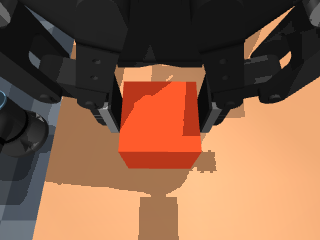
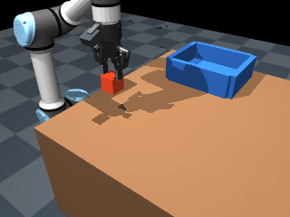

# Wrist-only versus wrist+fixed: visibility gate

Date: 2026-10-15. Scope: current articulated UR5e/2F85/wrist RGB, local fixed-step
simulation, unchanged camera mounting and safety. The
[plan](../plans/wrist-camera-study.md) defined thresholds before inspecting the
first seed. No 5,000-update policy pilot or new training cohort was started.

[Machine-readable metrics](wrist-camera-metrics.json) retain per-seed gates,
source/calibration hashes, diagnostic byte measurements and the no-go outcome.

## Measured decision

All ten expert episodes on seeds 19000–19009 completed successfully. Each
critical phase required at least 95% visible sampled frames in every seed,
with visible defined as at least 16 actual rendered target-geom pixels.

| Phase / required target | Wrist visible / sampled | Worst wrist seed | Wrist+fixed visible / sampled |
| --- | ---: | ---: | ---: |
| Approach / cube | 31/31 | 100% | 31/31 |
| Descent / cube | 98/98 | 100% | 98/98 |
| Transfer / tray | 230/244 | 76.9% | 244/244 |
| Lowering / tray | 64/64 | 100% | 64/64 |

Wrist fails transfer visibility on four of ten seeds. Paired input passes every
required phase on all ten. The exact seed/phase values, sampled timestamps,
camera calibration, model hashes and full resolved configuration are in ignored
audit artifacts. Phase-entry samples supplement the 5 Hz grid, so this is
sampled visibility evidence, not a continuous visibility guarantee.

The actual staged runner returned `completed_observation_no_go` with
`training_started: false`. It executed only the audit command. No final seeds
22000–22099 were evaluated or consumed for tuning.

## Same-state example

At the start of transfer on seed 19000, the wrist sees the cube held by the
gripper and the table; the tray is outside the image. The fixed view contains
the tray and held cube. These are simulator RGB images, not operator webcam data.

| Wrist | Fixed policy view |
| --- | --- |
|  |  |

## Conversion and pipeline evidence

Two retained quality-valid raw episodes were independently revalidated and
converted at 25 Hz into wrist and paired diagnostic datasets. Both contain
551 frames. Arrow comparison checked every state/action/timestamp/index value
and encoded wrist-image bytes for exact equality; episode split files also
match. These two diagnostic episodes are not a sufficient training cohort and
are not part of the frozen 20000–20039 study collection.

Measured complete dataset storage was **31,377,421 bytes paired** versus
**11,456,285 bytes wrist-only**, a **63.5% reduction** on these two episodes.
This includes metadata and reflects different image compressibility; it is not
a forecast for a larger cohort. Values are retained in the local
`runs/wrist-camera-study/projection-equivalence.json`, separately from any unrun
training-time or inference-speed comparison. The implementation tests
cover projection, strict calibration binding, matching cohorts, frozen seed
rules, exact visibility/quality thresholds and no-go stopping before GPU use.

## Limits and next choice

This is a conservative observation gate, not proof that wrist-only learning
cannot work. Proprioception, task priors or observation history could support
placement while the tray is unseen. This baseline deliberately requires visual
context during the defined phases before spending a training budget.

Use wrist+fixed as the next candidate for training on this mounting, omitting
overview from learning acquisition. It still needs dataset and policy quality
qualification. Wider wrist optics, active looking or a different visibility
criterion must be designed and frozen separately. No hardware, real-time camera
performance, new learned-policy success rate or automatic Hub publication is
claimed.

## Acceptance evidence

- Dev build, Ruff, mypy (81 source files), doctor and diff checks passed.
- Full dev suite: 415 passed, six expected optional learning/display skips.
- The pinned CPU learning runtime passed actual one/two-camera conversion,
  tiny training/resume and calibrated inference, including missing-image holds.
  These tests establish mechanics, not useful learned task performance.
- Final CPU learning/conversion suite: ten passed. Standalone dev-image checks
  without a source bind mount: twelve passed, including the packaged runner.
- The final audit ran on source commit `15a71bde5125a0aeef1b47c2fe56a41e3f3446c1`.
  Every sampled row and gate exactly matched the earlier frozen audit. Source
  file hashes are recorded; an unrelated untracked local log marked Git dirty.
- The pipeline no-go path was exercised and never started collection or a GPU
  pilot. Total local study artifacts remained approximately 42 MiB.

Hosted CI and human review are tracked on the implementing draft PR.
